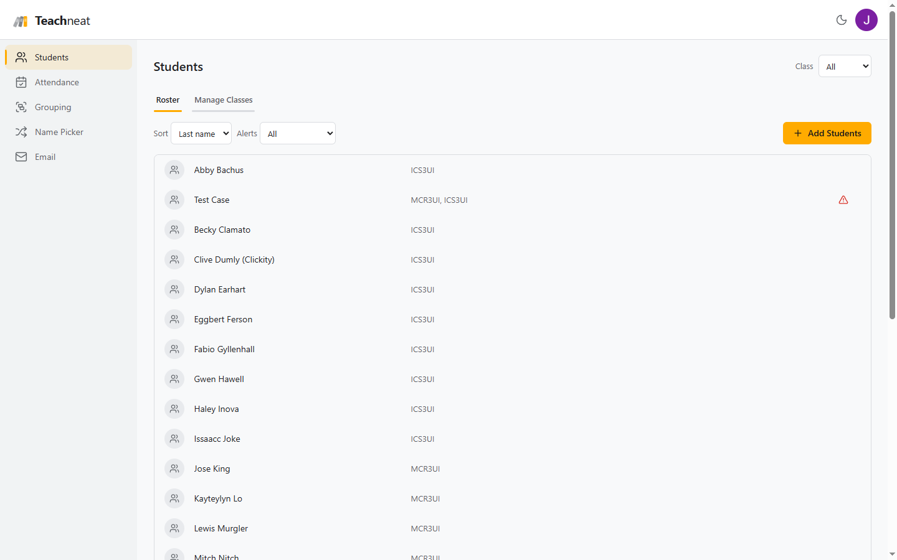

# Teachneat

Teachneat was a web app for secondary school teachers that combined attendance, grouping, a random name
picker and personalized parent email around a single class list stored in a Google Sheet on the teacher's own
Drive. I researched, designed, built and operated it from January to October 2026, took it to production
with Google's OAuth app verification approved, ran a structured test with teaching colleagues, and retired it
when the test showed no repeat use.

**Read the case study:** [`portfolio/index.html`](portfolio/index.html). It covers the discovery research,
the requirements and their targets, the product decisions, the test design and results, and the reasoning
behind the decision to stop. The screenshots in
[`portfolio/screenshots`](portfolio/screenshots) were captured from a demonstration account with invented
students before the site was retired.

## At a glance

| | |
|---|---|
| Role | Sole founder: research, product, engineering, operations |
| Research | 39-response teacher survey and 4 interviews, January 2026 |
| Stack | React 19, TypeScript, Vite, Tailwind; Express 5, Postgres; Google Sheets, Drive and Gmail APIs; Stripe |
| Scale of the build | 281 commits, about 36,000 lines of TypeScript, 1,139 automated tests |
| Outcome | Sunset in October 2026, before insurance, legal and tax commitments were made |

## What is in this repository

- `client/` and `server/`: the application. The server holds the Google tokens and calls Google's APIs on the
  teacher's behalf; student data lives only in the teacher's spreadsheet.
- Planning documents at the root: `IMPLEMENTATION_PLAN.md` (phases, design principles and the Phase 3
  backlog), `DESIGN_SYSTEM.md`, `TESTING_PLAN.md`, `SHEETS_SCHEMA.md`, `API_CONTRACT.md` and
  `DEPENDENCIES.md`. `HISTORY.md` is the full work log and the record of decisions with their rationale.
- `ops/`: the incident response plan, the backup and restore procedure and its test record, and the OAuth scope
  justification submitted to Google.
- `portfolio/`: the case study, screenshots, the aggregate data behind its charts, and a summary for resumes
  and interviews.

## Data and privacy notes

No student data is included anywhere in this repository. The usage figures in the case study are aggregate
counts read from the production database, which never stored student data. The exit poll was anonymous and
collected no names or email addresses. This repository was published as a fresh copy without the private
repository's history.

## Running it

The app needs a Google Cloud OAuth client, a Postgres database and a Google Cloud KMS key; the variables are
listed in `server/.env.example`. Client: `cd client && npm install && npm run dev`. Server:
`cd server && npm install && npm run dev`. Tests: `npm test` in each directory.
